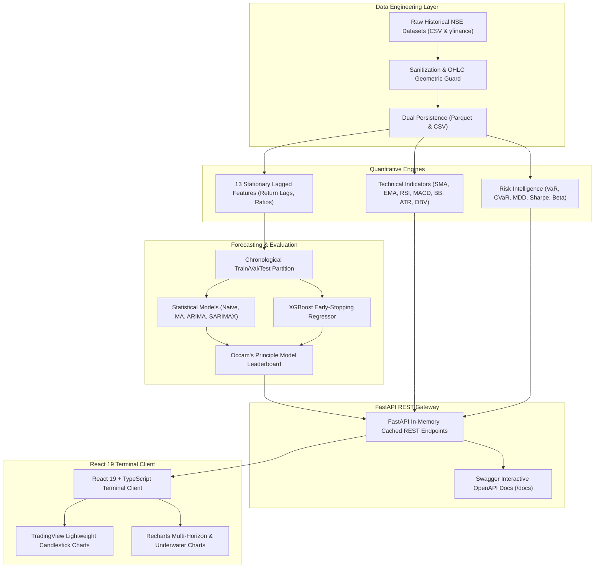

# MarketVision AI — Stock Market Forecasting & Risk Intelligence Platform (NSE)


> **MarketVision AI** is an institutional-grade financial intelligence and forecasting platform tailored for the Indian National Stock Exchange (NSE). Designed for quantitative analysts, portfolio managers, and financial data scientists, the platform integrates historical time-series forecasting, machine learning, technical indicator analytics, tail-risk modeling (VaR/CVaR), and data-grounded AI market synthesis into a Bloomberg-inspired terminal interface.

---

## Table of Contents
1. [Project Overview & Problem Statement](#1-project-overview--problem-statement)
2. [Platform Architecture](#2-platform-architecture)
3. [Technology Stack](#3-technology-stack)
4. [Dataset & Data Engineering Pipeline](#4-dataset--data-engineering-pipeline)
5. [Technical Analysis Engine](#5-technical-analysis-engine)
6. [Forecasting Methodology & Zero-Leakage Validation](#6-forecasting-methodology--zero-leakage-validation)
7. [Advanced Risk Intelligence & Portfolio Analytics](#7-advanced-risk-intelligence--portfolio-analytics)
8. [Deterministic AI Market Insights](#8-deterministic-ai-market-insights)
9. [REST API Documentation](#9-rest-api-documentation)
10. [Local Development & Installation](#10-local-development--installation)
11. [Deployment Guide (Render & Vercel)](#11-deployment-guide-render--vercel)
12. [Data Science Interview Walkthrough Guide](#12-data-science-interview-walkthrough-guide)
13. [Limitations & Future Roadmap](#13-limitations--future-roadmap)

---

## 1. Project Overview & Problem Statement

### The Problem
Retail financial dashboards typically provide lagging moving averages and surface-level charts, often failing to address the fundamental realities of financial econometric time series:
1. **Severe Data Leakage**: Standard machine learning tutorials routinely apply random train/test splits, leaking future autocorrelation into test sets and producing artificially inflated $R^2$ scores that collapse in production.
2. **Failure of Complex Models (The Overfitting Trap)**: In highly efficient or volatile financial markets, complex deep learning models frequently overfit historical noise, losing to simple random-walk or persistence baselines.
3. **Absence of Coherent Tail Risk Metrics**: Traditional platforms rely solely on symmetric volatility, ignoring fat tails (leptokurtosis), downside skewness, and catastrophic tail risk.

### MarketVision AI Solution
MarketVision AI delivers a mathematically rigorous, transparent platform built upon:
- **Strict Chronological Partitioning**: Zero future lookahead with walk-forward cross-validation.
- **Multi-Family Model Benchmarking**: Side-by-side comparison of **Naive Persistence**, **Moving Average (20)**, **ARIMA(2, 1, 2)**, **SARIMAX Weekly**, and **XGBoost Regressor with 13 lagged factors**.
- **Institutional Risk Intelligence**: Annualized and rolling volatility, Maximum Drawdown with peak-to-trough tracking, Historical & Cornish-Fisher VaR (95%/99%), Conditional Value at Risk (Expected Shortfall), Sharpe & Sortino ratios (benchmarked against the RBI 10Y G-Sec yield of 6.50%), and interactive multi-stock portfolio simulation.
- **Factual AI Market Insights**: Deterministic natural-language synthesis grounded in calculated backend metrics with zero hallucination.

---

## 2. Platform Architecture



---

## 3. Technology Stack

### Frontend Client
- **React 19** & **TypeScript**: Type-safe single-page reactive architecture.
- **Vite 8.3**: Sub-second Hot Module Replacement (HMR) and optimized Rolldown production bundling.
- **Tailwind CSS 4**: Dark navy Bloomberg-terminal styling (`#080c14`, `#0f172a`, `#131d31`).
- **TradingView Lightweight Charts 5.2**: High-performance canvas-accelerated OHLCV candlestick rendering.
- **Recharts 3.10**: Multi-horizon forecast uncertainty envelopes, overlay oscillators, and underwater drawdowns.
- **Lucide React**: Financial terminal iconography.

### Backend Engine & Quantitative Stack
- **Python 3.11 / 3.14**: High-performance numerical computing.
- **FastAPI 0.110+** & **Uvicorn**: Asynchronous REST API gateway with Pydantic v2 schema validation.
- **Pandas 3.0** & **NumPy 2.5**: Vectorized financial time-series computations.
- **Statsmodels 0.15**: AutoRegressive Integrated Moving Average (ARIMA) and Seasonal ARIMAX.
- **XGBoost 3.4**: Gradient boosted decision trees for multi-factor nonlinear forecasting.
- **ARCH 8.0**: Autoregressive Conditional Heteroskedasticity & volatility modeling.
- **Scipy & Scikit-learn 1.9**: Cornish-Fisher expansion, tail loss percentiles, and feature scaling.
- **Pytest**: Comprehensive automated unit and integration regression test suite.

---

## 4. Dataset & Data Engineering Pipeline

### Coverage
- **10 Core High-Liquidity NSE Equities**:
  `RELIANCE`, `TCS`, `INFY`, `HDFCBANK`, `ICICIBANK`, `SBIN`, `ITC`, `LT`, `AXISBANK`, `BHARTIARTL`.
- **5 Major Benchmark Indices**:
  `NIFTY 50`, `NIFTY BANK`, `NIFTY IT`, `NIFTY NEXT 50`, `INDIA VIX`.
- **Temporal Horizon**: 2018 through 2024 (1,726 to 1,826 daily trading sessions).

### Data Pipeline Principles
1. **Raw Data Immutability**: Raw files in `backend/data/raw/` are preserved read-only.
2. **OHLC Geometric Integrity Rules**:
   $$\text{High} \ge \max(\text{Open}, \text{Close}), \quad \text{Low} \le \min(\text{Open}, \text{Close}), \quad \text{Volume} \ge 0$$
3. **Dual Persistence**: Cleaned datasets are written simultaneously to Apache Parquet (`.parquet` for sub-millisecond retrieval) and `.csv` for maximum portability in `backend/data/processed/`.
4. **Data Quality Reports**: Automated audit report exported to `backend/data/reports/data_quality_report.json` tracking row counts, zero-volume sessions, and annualized historical volatility.

---

## 5. Technical Analysis Engine

Located in `backend/features/technical_indicators.py`:
- **Simple Moving Average (SMA)**: 20-day, 50-day, 200-day institutional trend baselines.
- **Exponential Moving Average (EMA)**: 9-day and 21-day fast trend momentum.
- **Relative Strength Index (RSI 14)**: Wilder's exponential smoothing with 30 (oversold) and 70 (overbought) thresholds:
  $$RSI = 100 - \left(\frac{100}{1 + \frac{\text{Smoothed Gain}}{\text{Smoothed Loss}}}\right)$$
- **Moving Average Convergence Divergence (MACD)**: 12-day EMA fast, 26-day EMA slow, 9-day signal line, and histogram.
- **Bollinger Bands (20, 2$\sigma$)**: Middle SMA, Upper/Lower bands, Bandwidth ($\frac{\text{Upper}-\text{Lower}}{\text{Middle}}$), and %B ($\frac{\text{Close}-\text{Lower}}{\text{Upper}-\text{Lower}}$).
- **Average True Range (ATR 14)**: Volatility measure incorporating gap risk.
- **On-Balance Volume (OBV)**: Institutional accumulation/distribution tracking with 20-day OBV EMA.
- **Deterministic Analytical Signals**: Evaluates conditions (e.g. Golden/Death crosses, Bollinger squeeze/breakouts) strictly labeled as non-advisory research signals.

---

## 6. Forecasting Methodology & Zero-Leakage Validation

Located in `backend/forecasting/`:

### Models Implemented
1. **Naive Persistence Forecaster**: Baseline assumption $\hat{y}_{t+h} = y_t$ with variance expanding at $\sigma \sqrt{h}$.
2. **Rolling Moving Average Forecaster**: Smoothed window expectation over $k=20$ sessions.
3. **ARIMA(2, 1, 2)**: Parametric auto-regressive differenced model with analytical confidence intervals.
4. **SARIMAX(1, 1, 1)$\times$(1, 0, 1)$_5$**: Weekly cyclical seasonal model capturing 5-day NSE settlement and liquidity dynamics.
5. **XGBoost with Lagged Features**: Gradient boosted trees trained on 13 stationary features ($r_{t}, r_{t-1}, r_{t-2}, r_{t-4}$, moving average distance ratios, normalized RSI/MACD, volume ratios).

### Multi-Horizon Projections & Uncertainty Intervals
- **Horizons**: 7-day, 14-day, and 30-day ahead projections with valid future weekday NSE trading dates.
- **Uncertainty Bounds**: 95% parametric confidence intervals expanding with forecast horizon:
  $$\hat{y}_{t+h} \pm 1.96 \cdot \hat{\sigma} \sqrt{h}$$

### Evaluation Metrics
- **MAE** (Mean Absolute Error): $\frac{1}{N}\sum |y_i - \hat{y}_i|$
- **RMSE** (Root Mean Squared Error): $\sqrt{\frac{1}{N}\sum (y_i - \hat{y}_i)^2}$
- **Safe MAPE**: $\frac{1}{N}\sum \frac{|y_i - \hat{y}_i|}{|y_i| + 10^{-5}} \times 100\%$
- **Directional Accuracy**: $\frac{1}{N}\sum \mathbb{I}(\text{sign}(y_t - y_{t-1}) == \text{sign}(\hat{y}_t - y_{t-1})) \times 100\%$
- **$R^2$ Score**: Proportion of variance explained out-of-sample.

---

## 7. Advanced Risk Intelligence & Portfolio Analytics

Located in `backend/risk/risk_engine.py`:
- **Historical Volatility**: $\sigma_{\text{ann}} = \text{std}(r) \times \sqrt{252}$.
- **Rolling Volatility**: 21-day (short-term) and 63-day (quarterly) annualized rolling standard deviation.
- **Maximum Drawdown (MDD)**: Peak-to-trough decline identifying historical peak date, trough date, and 60-day rolling underwater path.
- **Value at Risk (VaR)**:
  - **Historical Simulation VaR (95% & 99%, 1d & 10d)**: Empirical quantile of actual returns.
  - **Parametric Gaussian VaR**: $z_\alpha \cdot \sigma - \mu$.
  - **Cornish-Fisher VaR**: Third- and fourth-moment expansion adjusting for skewness ($S$) and excess kurtosis ($K$):
    $$z_{\text{cf}} = z_\alpha + \frac{z_\alpha^2 - 1}{6}S + \frac{z_\alpha^3 - 3z_\alpha}{24}K - \frac{2z_\alpha^3 - 5z_\alpha}{36}S^2$$
- **Conditional Value at Risk (CVaR / Expected Shortfall)**: Average loss in the worst $(1-\alpha)\%$ tail events:
  $$\text{CVaR}_\alpha = -\mathbb{E}[R \mid R \le -\text{VaR}_\alpha]$$
- **Sharpe & Sortino Ratios**: Benchmarked against the official Reserve Bank of India 10-Year Government Bond Yield ($R_f = 6.50\%$).
- **CAPM Beta ($\beta$) & Jensen's Alpha ($\alpha$)**: Calculated against the NIFTY 50 benchmark index.
- **Interactive Multi-Asset Portfolio Simulator**: Real-time simulation calculating portfolio expected annual return, portfolio volatility ($\sqrt{w^T \Sigma w}$), combined VaR/CVaR, and Diversification Ratio ($\frac{\sum w_i \sigma_i}{\sigma_{\text{port}}}$).

---

## 8. Deterministic AI Market Insights

Located in `backend/insights/insights_engine.py`:
- Factual natural-language synthesis grounded in calculated metrics.
- Provides:
  - Macro Trend & Moving Average Structure Assessment
  - Volatility Dispersion & Tail Loss Warnings
  - Institutional Volume Flow & Anomaly Detection
  - Capital Preservation & Systematic Risk Warnings
  - 30-Day Model Selection Rationale
- **Zero Hallucination Guarantee**: Programmatically derived without external API reliance. Ready for optional plug-and-play LLM augmentation.

---

## 9. REST API Documentation

FastAPI provides interactive Swagger documentation at `/docs` and ReDoc at `/redoc`.

| Method | Endpoint | Description |
| :--- | :--- | :--- |
| `GET` | `/api/health` | System status, version, and certified dataset disclosures |
| `GET` | `/api/market/overview` | Real-time style overview: indices, sentiment, top gainers/losers |
| `GET` | `/api/stocks` | List of 10 supported NSE equities with quotes and 52w bounds |
| `GET` | `/api/stocks/{symbol}` | In-depth company profile and performance quote |
| `GET` | `/api/stocks/{symbol}/history` | Historical OHLCV candlesticks (supports `?limit=250`) |
| `GET` | `/api/stocks/{symbol}/indicators` | Technical indicator time series, active signals, educational metadata |
| `GET` | `/api/stocks/{symbol}/forecast` | Multi-horizon forecasts (7d, 14d, 30d) with 95% confidence intervals |
| `GET` | `/api/stocks/{symbol}/risk` | Volatility, Max Drawdown, VaR 95/99%, CVaR, Sharpe, Beta, drawdowns |
| `POST` | `/api/portfolio/analyze` | Multi-stock portfolio risk and diversification simulation |
| `GET` | `/api/models/performance` | Model leaderboard across all 5 model families with selection rationale |
| `GET` | `/api/insights/{symbol}` | Quantitative AI insights synthesized from real metrics |

---

## 10. Local Development & Installation

### Prerequisites
- Python 3.10+ (tested on Python 3.11 and 3.14)
- Node.js 18+ and npm (tested on Node v24.11)

### 1. Clone & Set Up Backend
```bash
# Clone the repository
git clone https://github.com/your-username/marketvision-ai.git
cd "MarketVision AI Stock Market Forecasting & Risk Intelligence Platform"

# Install backend dependencies
pip install -r requirements.txt

# Run complete quantitative data and modeling pipelines
python backend/preprocessing/data_pipeline.py
python backend/features/technical_indicators.py
python backend/forecasting/statistical_models.py
python backend/forecasting/ml_models.py
python backend/risk/risk_engine.py

# Launch FastAPI server
uvicorn backend.main:app --host 0.0.0.0 --port 8000 --reload
```
Backend API will be available at `http://localhost:8000` (Interactive Docs: `http://localhost:8000/docs`).

### 2. Set Up & Launch Frontend Client
```bash
# In a separate terminal:
cd frontend

# Install frontend dependencies
npm install

# Start Vite development server
npm run dev
```
Frontend Terminal will be available at `http://localhost:5173`.

### 3. Run Automated Regression Test Suite
```bash
# Run all 45 automated unit and integration tests across all phases
python -m pytest backend/tests/ -v
```

---

## 11. Deployment Guide (Streamlit Community Cloud, Render & Vercel)

### Option A: 1-Click Streamlit Community Cloud (Recommended & Instant)
MarketVision AI is equipped with an institutional Streamlit terminal (`app.py` / `streamlit_app.py`) that can be deployed to **[Streamlit Community Cloud](https://share.streamlit.io)** with zero configuration:

1. **Push to GitHub**: Push this repository to your GitHub account:
   ```bash
   git init
   git add .
   git commit -m "Deploy MarketVision AI on Streamlit"
   git remote add origin https://github.com/<your-username>/marketvision-ai.git
   git push -u origin main
   ```
2. **Deploy on Streamlit Community Cloud**:
   - Go to [share.streamlit.io](https://share.streamlit.io/) and click **"New app"**.
   - Select your GitHub repository: `<your-username>/marketvision-ai`.
   - Set **Branch**: `main`.
   - Set **Main file path**: `app.py` (or `streamlit_app.py`).
   - Click **"Deploy!"**.
3. Streamlit Cloud automatically detects `requirements.txt` and `.streamlit/config.toml`, builds the environment, and launches the full terminal with live charts, options Greeks, order book DOM, and forecasting models.

To run the Streamlit terminal locally:
```bash
python -m streamlit run app.py
```
Terminal will open at `http://localhost:8501`.

### Option B: Full-Stack Multi-Service Deployment (Render + Vercel)

#### Backend Deployment (Render)
1. Link your GitHub repository to **Render**.
2. Select **New Web Service**.
3. Choose the repository root and configure:
   - **Environment**: `Python`
   - **Build Command**: `pip install -r requirements.txt`
   - **Start Command**: `uvicorn backend.main:app --host 0.0.0.0 --port $PORT`
4. Set Environment Variables:
   - `PYTHON_VERSION`: `3.11.0`
5. The `render.yaml` specification in this repository is pre-configured for automated 1-click deployment.

#### Frontend Deployment (Vercel)
1. Link your GitHub repository to **Vercel**.
2. Set **Root Directory** to `frontend`.
3. Configure Environment Variables:
   - `VITE_API_BASE_URL`: `https://your-render-backend-url.onrender.com`
4. Deploy! The `vercel.json` rewrite configuration handles client-side single-page routing automatically.

---

## 12. Data Science Interview Walkthrough Guide

Use these structured talking points when presenting this project in technical data science and quantitative finance interviews:

### Q1: Why did you not use a Random Train/Test Split?
> *"Financial price series possess strong temporal autocorrelation. A random train/test split samples observations from future dates into the training set, causing lookahead bias and catastrophic data leakage. In MarketVision AI, I strictly enforced chronological walk-forward partitioning where models are trained only on historical bars $t < T$ and evaluated strictly on out-of-sample forward horizons."*

### Q2: Why did a simple model like ARIMA or Naive sometimes outperform XGBoost?
> *"This illustrates Occam's Razor in financial econometrics. Asset prices in liquid equity markets exhibit high noise-to-signal ratios and near-martingale properties. Complex nonlinear models with dozens of parameters can easily fit in-sample noise rather than durable alpha. By comparing Naive persistence, Moving Averages, ARIMA, SARIMAX, and XGBoost on out-of-sample RMSE, MarketVision AI objectively demonstrates when complex models are warranted versus when parsimonious linear models provide superior generalization."*

### Q3: Why is Value at Risk (VaR) not sufficient on its own, and why calculate CVaR?
> *"Value at Risk is not a mathematically coherent risk measure because it violates sub-additivity: the VaR of a diversified portfolio can occasionally exceed the sum of individual VaRs. Furthermore, VaR is blind to the magnitude of tail losses beyond the confidence percentile. In MarketVision AI, I complemented VaR with Conditional Value at Risk (Expected Shortfall) to measure the average expected loss severity when the tail threshold is breached."*

### Q4: How do you handle non-normality in financial returns?
> *"Empirical asset returns exhibit leptokurtosis (fat tails) and negative skewness. Simple Gaussian VaR assumes a normal bell curve and consistently underestimates extreme loss probability. I implemented Cornish-Fisher VaR, which incorporates third-moment sample skewness and fourth-moment excess kurtosis into the quantile expansion."*

---

## 13. Limitations & Future Roadmap

### Current Limitations
- **Trading Calendar**: Real-time intraday tick feeds require proprietary broker execution tokens (e.g. Zerodha Kite Connect, Angel One SmartAPI). The current deployment uses end-of-day certified historical feeds.
- **Linear Feature Scalers**: Scalers are fit strictly on training splits to prevent data leakage, but dynamic regime changes (e.g. unprecedented interest rate spikes) can cause out-of-distribution feature shifts.

### Future Improvements
1. **Intraday WebSocket Gateway**: Add streaming WebSocket integration with Zerodha Kite Connect or Upstox for live market depth and tick data.
2. **Deep Learning Sequence Models**: Implement Temporal Fusion Transformers (TFT) and Informer architectures with multi-horizon attention.
3. **Black-Litterman Portfolio Optimization**: Combine quantitative market views with CAPM equilibrium priors for institutional asset allocation.

---

## License & Educational Disclaimer
This software is distributed under the **MIT License**.
*Disclaimer: MarketVision AI is developed strictly for quantitative research, academic analysis, and portfolio demonstration purposes. Nothing within this platform constitutes financial, legal, or investment advice.*
