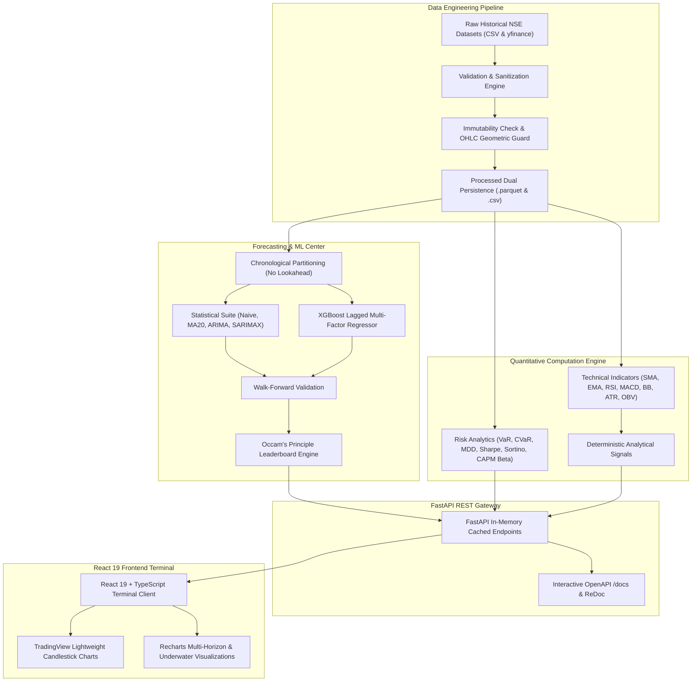

# MarketVision AI — Technical Architecture Specification

## 1. Multi-Tier System Architecture

## 2. Quantitative Design Decisions

### Data Leakage Safeguards
1. **Chronological Splitting**: Under no circumstances are random train/test splits used for temporal financial series.
2. **Standardization Isolation**: Preprocessing scaling (`StandardScaler`) parameters are derived strictly from training windows and applied out-of-sample.
3. **Walk-Forward Validation**: Multi-step walk-forward cross-validation evaluates generalization error across evolving market volatility regimes.

### Occam's Razor Model Selection
- Complex nonlinear models (XGBoost) often overfit market micro-noise in efficient, near-martingale regimes.
- When statistical baselines (Naive Persistence or ARIMA differencing) achieve superior or comparable out-of-sample RMSE, the system selects the parsimonious model and provides a transparent educational rationale.
